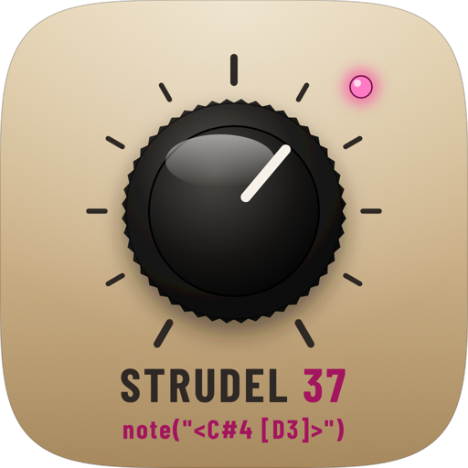
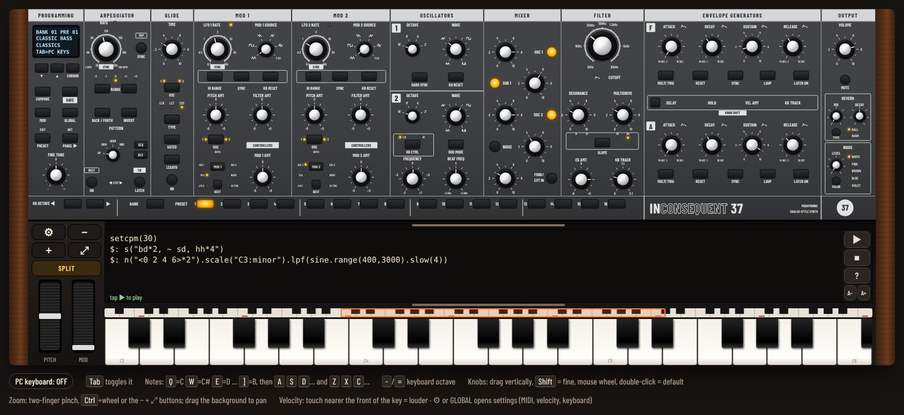

<div align="center">



# Strudel 37

**A virtual analog synthesizer and Strudel live coding in one app.**

A full panel for a 2-oscillator paraphonic synth, with keyboard, arpeggiator and 256 presets. Right below it sits a [Strudel](https://strudel.cc)-style code editor that plays musical patterns on the synth itself and on a built-in drum machine.




</div>

---

## Contents

- [Download and install](#download-and-install)
- [Repository layout](#repository-layout)
- [Getting started](#getting-started)
- [Using the synth](#using-the-synth)
- [Using Strudel](#using-strudel)
- [External MIDI](#external-midi)
- [Building the APK](#building-the-apk)
- [Architecture](#architecture)
- [License](#license)

---

## Download and install

### Android

1. Download [`Android/Strudel37.apk`](Android/Strudel37.apk).
2. Open the file on your phone or tablet and allow installs from unknown sources when Android asks.
3. Open **Strudel 37**. It works best in landscape.

Requires Android 7.0 (API 24) or newer. Sound comes from a native low-latency Java engine, and the app accepts MIDI keyboards over USB and Bluetooth.

### Browser (HTML)

The web version is a single file with no install and no dependencies: [`HTML/strudel37.html`](HTML/strudel37.html).

- The simplest way is to open the file directly in Chrome, Edge or Firefox.
- For the lowest latency, serve the folder over HTTP, because browsers only enable AudioWorklet outside `file://`:

  ```sh
  cd HTML
  python3 -m http.server 8000
  # open http://localhost:8000/strudel37.html
  ```

- You can also publish the `HTML/` folder on GitHub Pages and play from anywhere.

---

## Repository layout

```
strudel37/
├── Android/
│   └── Strudel37.apk          ready-to-install APK
├── HTML/
│   └── strudel37.html         web version (the same file ships inside the APK)
├── source/                    Android app source code
│   ├── src/com/wil/strudel37/
│   │   ├── MainActivity.java  full-screen WebView, soft keyboard, audio lifecycle
│   │   ├── SynthEngine.java   native synthesis engine (port of the JavaScript engine)
│   │   ├── NativeSynth.java   audio output (AudioTrack) and sample-accurate note scheduling
│   │   ├── DrumMachine.java   synthesized drum kit used by s("bd sd hh")
│   │   └── MidiBridge.java    USB and Bluetooth LE MIDI
│   ├── res/                   app icons
│   ├── axml.py                writes the binary AndroidManifest and resources.arsc
│   ├── zipalign.py            packs and aligns the APK
│   ├── signer/                signing (apksig, v2 scheme)
│   ├── icon.js                draws the icons
│   └── build.sh               build script
└── docs/                      images for this README
```

---

## Getting started

1. Tap the screen to turn audio on (browsers and Android need a tap before playing sound).
2. Play the keyboard. Touches nearer the front of a key play louder.
3. Pick a preset with **BANK** and **PRESET** on the bottom strip of the panel.
4. Open the code editor with the mode button (below ⚙ − + ⤢) and press **▶ Play** to hear the example.

The mode button switches the bottom area between three layouts:

| Mode | Shows |
|---|---|
| **KEYS** | the keyboard only |
| **SPLIT** | the Strudel editor above the keyboard, with a draggable divider |
| **CODE** | the editor only |

Drag the grip at the top of the bottom area to share the space between the panel and the code/keyboard.

---

## Using the synth

The panel is a 2-oscillator paraphonic synth with a 4-pole ladder filter, two envelopes, two modulation sections, an arpeggiator and effects.

### Panel sections

| Section | What it does |
|---|---|
| **PROGRAMMING** | display, preset navigation, **SAVE**, **COMPARE**, **INIT**, **GLOBAL** (settings), **MIDI** and **FINE TUNE** |
| **ARPEGGIATOR** | **RATE** (with **SYNC** and **TAP**), **RANGE** from -2 to +2 octaves, **PATTERN** (UP, DOWN, ORDER, RANDOM), **BACK / FORTH**, **INVERT**, **LATCH**, plus a step sequencer with **SEQ / REC / REST / TIE** |
| **GLIDE** | portamento: **TIME**, curve (**LCR**, **LCT**, **EXP**), **GATED**, **LEGATO** and which oscillator glides |
| **MOD 1 / MOD 2** | two modulation sources (LFO, filter envelope, osc 2 and more) with **PITCH AMT**, **FILTER AMT** and an extra destination (**DEST**: VCA, LFO, osc 2, noise, envelope time) |
| **OSCILLATORS** | two oscillators with **OCTAVE** (16' to 2') and a continuous **WAVE** (triangle → saw → square → pulse); **HARD SYNC**, **FREQUENCY** and **BEAT FREQ** on osc 2, and **DUO MODE** to play two notes |
| **MIXER** | levels for **OSC 1**, **SUB 1**, **OSC 2**, **NOISE** and **FDBK / EXT IN** (feedback to drive the filter) |
| **FILTER** | **CUTOFF**, **RESONANCE**, **MULTIDRIVE**, **SLOPE** (6/12/18/24 dB), **EG AMT** and **KB TRACK** |
| **ENVELOPE GENERATORS** | filter (**F**) and amplifier (**A**) envelopes: ATTACK, DECAY, SUSTAIN, RELEASE, plus **DELAY**, **HOLD**, **VEL AMT**, **LOOP**, **MULTI TRIG**, **RESET**, **SYNC** and **LATCH** |
| **OUTPUT** | **VOLUME** and **MUTE**, **REVERB** (MIX, DECAY, HALL or ROOM) and **NOISE** (LEVEL and COLOR: white, pink, brown, blue, violet) |

### Controls

| Action | How |
|---|---|
| Turn a knob | drag vertically |
| Fine adjust | drag with **Shift**, or use the mouse wheel |
| Reset to default | double click / double tap |
| Zoom the panel | two-finger pinch, **Ctrl** + wheel, or the **− + ⤢** buttons |
| Pan when zoomed | drag the background |
| Pitch bend and modulation | the **PITCH** and **MOD** wheels left of the keyboard |
| Keyboard octave | **KB OCTAVE ◀ ▶** on the panel |

### Presets

There are **256 factory presets** in 16 themed banks (CLASSICS, BASSES, LEADS, PADS, BRASS, PLUCKS, ARPS, FX, ACID, SYNC and more). Use **BANK** and **PRESET 1–16** to pick one. To keep your own sound, tweak the knobs and tap **SAVE**: it replaces the current slot and is stored on the device. **COMPARE** plays the original preset while you edit, and **INIT** goes back to a basic sound.

### Computer keyboard (HTML version)

Press **Tab** to turn the PC keyboard on:

- `Q W E R T Y U I O P [ ]` play C to B, and the `A S D F…` and `Z X C V…` rows continue below.
- `-` and `=` change the octave.

### Settings (⚙ or GLOBAL)

- **External MIDI**: scan for and connect MIDI keyboards.
- **Touch velocity**: turn on and tune touch sensitivity.
- **Sliding from key to key**: what happens when you drag a finger across the keys (glissando or a single note).
- **Keyboard**: key height and width, and the 88-key scroll strip.
- **Audio**: latency and audio engine info.

---

## Using Strudel

The code editor plays musical patterns in the style of [Strudel](https://strudel.cc) (the JavaScript port of TidalCycles). Notes go to the panel's synth, so the sound is always the current preset. Drum sounds come from a built-in drum machine mixed in with the synth.

| Action | How |
|---|---|
| Play or update | **▶ Play** or **Ctrl+Enter** |
| Stop | **■ Stop** or **Ctrl+.** |
| Examples, syntax and scales | the **?** button |
| Font size | **A−** / **A+** or pinch on the code |
| Symbols (`" < > [ ] ~ *`…) | the bar above the soft keyboard, with **◀ ▶** to move the cursor |

While a pattern plays, the sounding notes light up in the code, like on strudel.cc. Your code is saved automatically.

### The basics

```js
setcpm(30)                          // cycles per minute (or setcps(0.5))
note("<C#4 [D3 - - -]>")            // notes by name or MIDI number
n("<1 0 3>").scale("C:major")       // scale degrees
```

### Mini-notation

| Syntax | Meaning |
|---|---|
| `"a b c"` | steps share the cycle |
| `[a b]` | group into one step |
| `<a b>` | one per cycle, alternating |
| `-` or `~` | rest |
| `a*2` / `a/2` | faster / slower |
| `a!3` | repeat |
| `a@3` or `a _ _` | longer |
| `a?` | sometimes plays |
| `[c,e,g]` | chord |
| `a(3,8)` | Euclidean rhythm |
| `0 .. 7` | range |
| `a \| b` | random choice |
| `{a b c}%4` | polymeter |

### Layers and drums

```js
setcpm(30)
$: s("bd*2, ~ sd, hh*4")                       // drums
$: n("<0 2 4 6>*2").scale("C3:minor")          // melody on the synth
```

Each `$:` line is one pattern; write `_$:` to mute a layer. `stack(a, b)`, `cat(a, b)` and `seq(a, b)` work too.

Drum sounds: `bd sd hh oh cp rim lt mt ht cr rd cb sh` (and the long names `kick snare hat clap crash ride`…).

### Moving the panel from code

`.lpf` / `.cutoff`, `.lpq` / `.resonance`, `.shape` / `.distort`, `.room` and `.size` drive the panel's filter, drive and reverb while the pattern plays, and everything goes back when you stop:

```js
setcpm(30)
n("0 2 4 <6 7>").scale("A2:minor:pentatonic")
  .lpf(sine.range(400, 3000).slow(4))
  .room(0.4)
```

### Available functions

- **Time and structure:** `fast` `slow` `hurry` `early` `late` `rev` `palindrome` `iter` `iterBack` `ply` `chunk` `chunkBack` `inside` `outside` `zoom` `compress` `fastGap` `linger` `ribbon` `brak` `press` `swing` `swingBy` `segment` `range` `rangex`
- **Notes:** `scale` `scaleTranspose` `transpose` `add` `sub` `mul` `div` `mod` `round` `floor` `chord` `voicing` `rootNotes` `arp` `arpeggiate`
- **Rhythm and chance:** `struct` `mask` `euclid` `euclidRot` `degrade` `degradeBy` `undegradeBy` `sometimes` `often` `rarely` `almostNever` `almostAlways` `sometimesBy` `someCycles` `someCyclesBy` `when`
- **Layers:** `every` `firstOf` `lastOf` `off` `superimpose` `layer` `jux` `echo` `stut`, and the functions `stack` `cat` `seq` `timeCat` `stepcat` `polymeter` `arrange` `chooseCycles` `randcat` `run`
- **Signals:** `sine` `cosine` `saw` `isaw` `tri` `square` `rand` `perlin` `irand(n)` `choose` `wchoose`
- **Dynamics:** `velocity` `gain` `legato` `clip`

There are **96 scales** (with aliases), written as `"C:minor"`, `"D4:minor:pentatonic"` or `"<C:major A:minor>"`. The full list is under the **?** button.

### Examples

```js
// Voiced chords
setcpm(24)
chord("<C Am F G7>").voicing()
```

```js
// Euclidean bass
setcpm(30)
note("c2(3,8) <eb2 g2>(5,8)").legato(0.8)
```

```js
// Japanese scale, reversed every 2 cycles
setcpm(28)
n("0 .. 7").scale("D3:hirajoshi").every(2, x => x.rev())
```

```js
// Full groove
setcpm(30)
$: s("bd [~ bd] ~ bd, ~ cp ~ [cp rim], [hh hh oh hh]*2")
$: s("<~ lt> <~ mt> ht cr").gain(.7)
$: note("<c2 c2 eb2 g1>*4")
```

### Good to know

- The Strudel engine here is its own implementation, independent of the official library, focused on note and drum patterns.
- Sound calls from the original Strudel such as `.bank`, `.pan`, `.delay` and `.vowel` are ignored, because the panel makes the sound.
- Strudel notes skip the arpeggiator.
- The synth is paraphonic (up to two notes with **DUO MODE**), so chords and multiple layers share the same voices.

---

## External MIDI

- **Android:** USB keyboards (with an OTG cable) and Bluetooth LE MIDI. Open ⚙ → *External MIDI* to scan and connect.
- **Browser:** uses the Web MIDI API (Chrome and Edge).

Incoming MIDI notes and controls play straight into the sound engine and show up on the on-screen keyboard.

---

## Building the APK

The APK is built without Android Studio or the Android SDK, using only **JDK 17+** and **Python 3**.

1. Download these jars from Maven Central into `source/tools/`:
   - `org.robolectric:android-all:13-robolectric-9030017` (Android classes to compile against)
   - `com.jakewharton.android.repackaged:dalvik-dx:16.0.1` (writes `classes.dex`)
   - `com.android.tools.build:apksig:2.3.0` (signs the APK)
2. Put your signing key at `source/key.p12` (PKCS#12). It is not part of the repository.
3. Run:

   ```sh
   KEY_PASS=your_password sh source/build.sh
   ```

The build copies `HTML/strudel37.html` into the APK and writes the result to `Android/Strudel37.apk`.

> For a new version to install over the old one, sign with the same key and raise `versionCode` in `source/axml.py`. A new key makes an app that Android treats as a different one.

To create a new key:

```sh
keytool -genkeypair -keystore source/key.p12 -storetype PKCS12 \
  -alias strudel37 -keyalg RSA -keysize 2048 -validity 10000
```

---

## Architecture

- **Interface:** the whole app is the `strudel37.html` page (SVG panel, keyboard, editor and Strudel engine), running in a WebView on Android.
- **Sound in the browser:** the synth engine runs in an AudioWorklet (with a ScriptProcessor fallback), with the Strudel scheduler and the drums inside the same processor so notes land exactly on time.
- **Sound on Android:** `SynthEngine.java` is a line-by-line port of the JavaScript engine, played through a low-latency `AudioTrack` on a high-priority audio thread. The page only sends commands (`window.AndroidSynth`), and Strudel notes are scheduled on the exact sample of the audio clock.
- **MIDI:** `MidiBridge.java` exposes `window.AndroidMidi` (USB and Bluetooth LE) and plays straight into the native engine.

## License

Released under the [Apache License 2.0](LICENSE).

---

<div align="center">
Made by <a href="https://github.com/stants">@stants</a>
</div>
